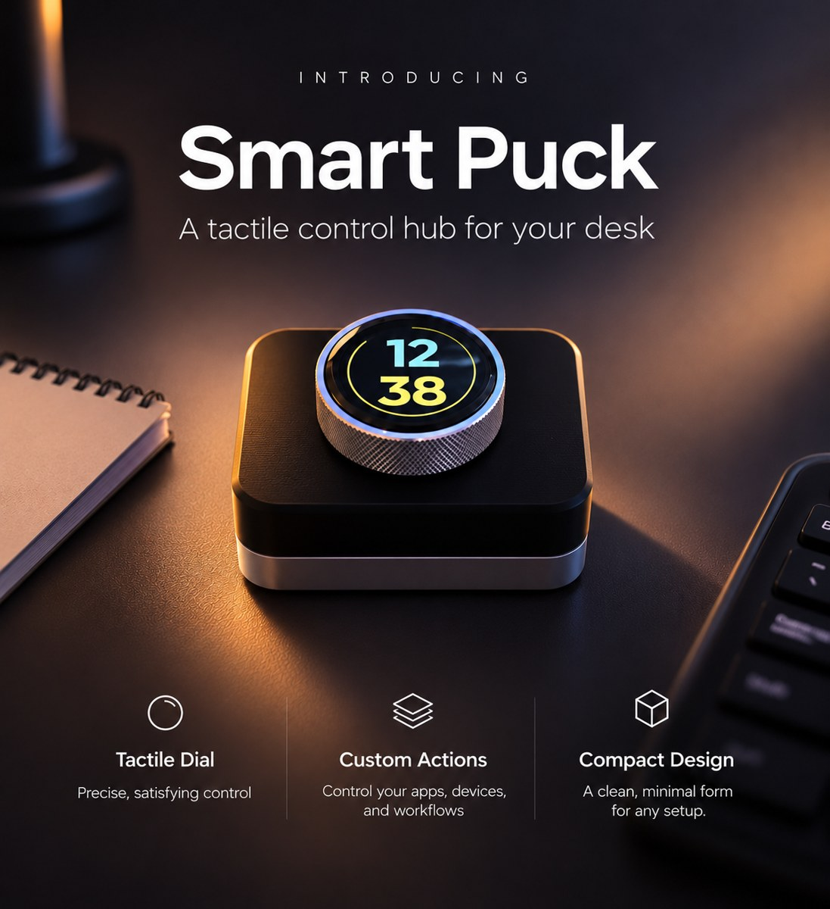
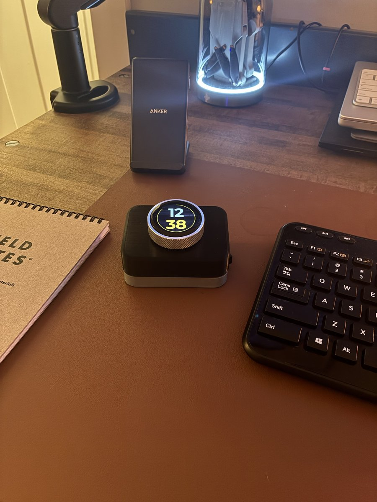
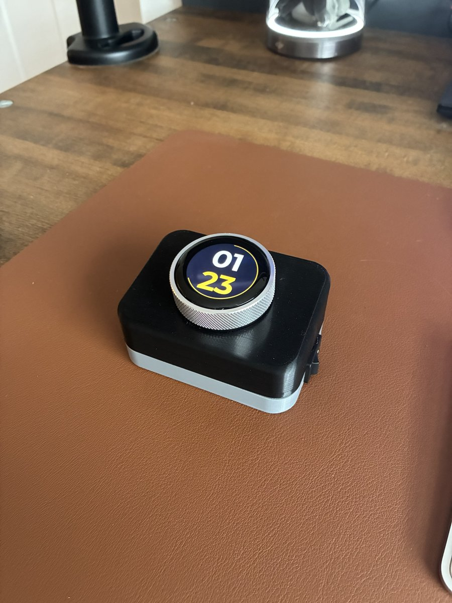
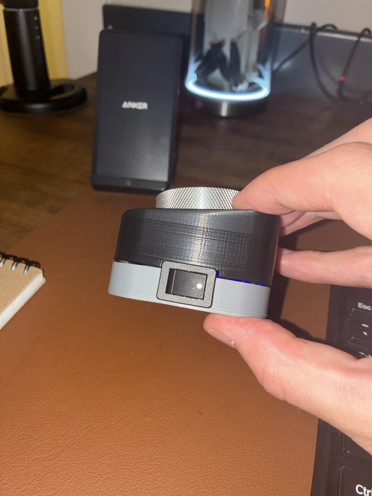
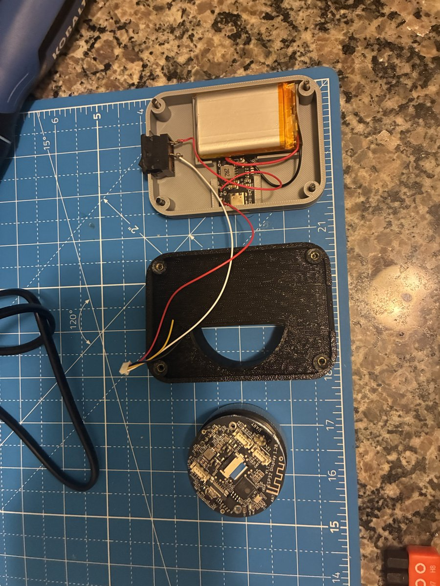

# Introducing the Smart Puck

**One dial. Endless possibilities.**

Meet the Smart Puck: a sleek, wireless desktop controller that puts your favorite shortcuts, apps and controls right at your fingertips.

Built around the [1.28" ESP32 rotary knob display](https://link.amazon/B03kXB6wJ), the Smart Puck combines a premium knurled aluminum dial, a vibrant circular touchscreen and a minimalist 3D-printed enclosure into one compact, customizable device.

  
  

## Customizable to your workflow

Switch browser tabs, scroll, navigate Bambu Studio, control media apps like Spotify, monitor your 3D printer's progress and much more, all with a simple twist or tap. With customizable firmware, the possibilities are entirely up to you. You can customize shortcuts for specific apps, or use the standard controls available to every Bluetooth peripheral (works on both Mac and Windows).

- **Sidekick mode** follows the app in front of you and hands the dial the right tools: tabs in your browser, slides in PowerPoint, view rotation in Bambu Studio, track and volume in Spotify, and a mute button when you're on a call.
- **Bluetooth keyboard** for two computers, with media keys and a scroll wheel. Nothing to install for the basics.
- **Spotify** now playing and controls, straight from the Spotify API over Wi-Fi.
- **3D printer status** from a Bambu Lab printer on your network, with alerts when a print pauses, fails or finishes.
- **Watch faces**, RGB glow and over-the-air firmware updates.

## Designed to print. Easy to assemble.

- Fully cordless design with room for a [103450 LiPo battery](https://link.amazon/B02DtfgWK)
- Integrated USB-C charging and a snap-in power switch, with a [Type-C USB 5V 2A boost converter step-up power module](https://link.amazon/B01md2LDM)
- Precision 46.2 mm opening for the [1.28" ESP32-S3 round knob touch display](https://link.amazon/B03kXB6wJ)
- [Four M3x16 screws](https://link.amazon/B0aCaM2bR) for secure assembly. Heat-set inserts are optional and can be installed with a [soldering iron with a heat-set insert tool](https://link.amazon/B0j9AnaSR)
- Support-free printing with both parts oriented flat on the build plate
- Compact, minimalist aesthetic that looks at home on any desk setup

Printed on a [Bambu A1 mini](https://link.amazon/B0hqkkMkx) in [black](https://link.amazon/B0hBDP492) and [grey](https://link.amazon/B08KjhbuN) PLA+, the Smart Puck is designed to be as easy to build as it is satisfying to use.

  
  

## Build your own

1. **Get the parts.** Everything is listed in [PARTS.md](PARTS.md).
2. **Print the case.** `hardware/stl/puck_tub.stl` and `hardware/stl/puck_lid.stl`, flat on the bed, or open the ready-to-print Bambu Studio project `hardware/Smart-Puck-Final-Fall-26.3mf`. Print settings and the knob fit test are in [hardware/README.md](hardware/README.md).
3. **Flash the firmware** onto the display over USB before you close it up. See [firmware/README.md](firmware/README.md).
4. **Wire and assemble it.** The [assembly guide (PDF)](docs/assembly-guide.pdf) walks through the wiring, a multimeter check and assembly step by step. Plan on about an hour, most of it soldering.
5. **Set it up.** Join the puck's **Smart Puck setup** Wi-Fi network from your phone to connect it to your Wi-Fi, then pair it over Bluetooth from **Settings > Bluetooth**.

> **Wiring safety:** match the 4-pin plug by pin position, not by wire color. On many of these pigtails the colors don't follow the usual red = positive convention. Check with a multimeter before plugging in the display.

## Try it in your browser

Open [`simulator/puck-sim.html`](simulator/puck-sim.html) in any browser to try the puck's screens, modes and dial on screen. You can edit what each turn and press does and export the result as a lineup for the puck with `firmware/tools/send_modes.py`.

## What's in this repo

| Folder | What's in it |
|--------|--------------|
| [`hardware/`](hardware/) | Printable STL files, a knob fit-test plate, and the parametric Python generator for the case |
| [`firmware/`](firmware/) | ESP32-S3 firmware (PlatformIO, Arduino, LVGL) and computer-side tools: companion apps for Windows and macOS, Spotify link, serial monitor |
| [`simulator/`](simulator/) | Browser simulator of the puck's screens and modes |
| [`docs/`](docs/) | Assembly guide and photos |
| [`PARTS.md`](PARTS.md) | Parts list with links |

## Your desk. Your controls. Your Smart Puck.

Whether you're streamlining your workflow, controlling your music or building your AI agent workforce, the Smart Puck turns a simple rotary dial into a powerful desktop companion.

Product links are Amazon affiliate links. As an Amazon Associate I earn from qualifying purchases.
