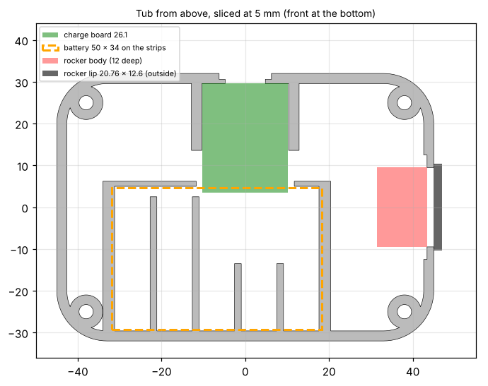

# Smart Puck enclosure

A two-part printed case: a **tub** that holds the battery, charge board and power switch, and a **lid** with a tilted pocket the knob display presses into.



## Files

| File | What it is |
|------|------------|
| `stl/puck_tub.stl` | Bottom half. Battery strips, charge-board rails, USB-C slot, rocker notch, screw counterbores and foot recesses. |
| `stl/puck_lid.stl` | Top half. 46.2 mm knob pocket, 18 mm deep, tilted 7.5° toward you, with a D-shaped cord opening. |
| `stl/fit_test_knob_hole_46.0-46.6.stl` | Small plate with four holes (46.0, 46.2, 46.4 and 46.6 mm, marked with 1 to 4 dots) to check the knob's press fit on your printer before printing the lid. |
| `Smart-Puck-Final-Fall-26.3mf` | Ready-to-print Bambu Studio project for the A1 mini: the tub and lid on two plates, 0.12 mm layers, 4 walls, 40% gyroid infill. Open it in Bambu Studio, check the filament and printer profiles, and slice. |
| `source/shell_model.py` | Parametric Python generator for the case. Every dimension is a named parameter at the top. |

## Printing

| | Tub | Lid |
|---|---|---|
| Orientation | Floor down, as exported | Flat split face down, as exported |
| Supports | None | None |
| Material | PLA+ (grey on the reference build) | PLA+ (black on the reference build) |
| Suggested settings | 0.2 mm layers, 3 walls, 15–20% infill | 0.2 mm layers, 3 walls, 15–20% infill |

Assembled, the case is 90 × 64 mm and 38.5 mm tall at the centre. The tub is 13 mm tall and the lid sits on top of it.

**Knob fit.** The 46.2 mm pocket gives a snug press fit on a Bambu Lab A1 mini. Printers differ, so if the knob is loose or won't go in, print the fit-test plate, find the hole that grips, and set `POCKET_D` in the generator to match.

**Screws.** The four M3 × 16 screws go up through counterbores in the tub and thread into 2.6 mm pilot holes in the lid. Heat-set inserts are optional: if you use them, open the holes to the diameter your inserts specify (usually about 4 mm) before pressing them in.

## Regenerating the STLs

```
python -m pip install numpy manifold3d
cd hardware/source
python shell_model.py
```

The script writes the STLs to `hardware/source/stl/`. Useful parameters:

| Parameter | Default | What it controls |
|-----------|---------|------------------|
| `L, W, H` | 90, 64, 38.5 | Case outline and height (mm) |
| `TILT_DEG` | 7.5 | Tilt of the top face toward you |
| `POCKET_D` | 46.2 | Knob pocket diameter |
| `KNOB_INSERT` | 18.0 | Pocket depth (the knob's insertable base) |
| `CORD_CUT` | 20 | Size of the D-shaped cord opening |
| `BAT_T` | 10.0 | Battery thickness |
| `CB_W` | 20.4 | Charge board width (rail spacing) |
| `RK_LIP` | 20.76 × 12.6 | Rocker switch lip size |
